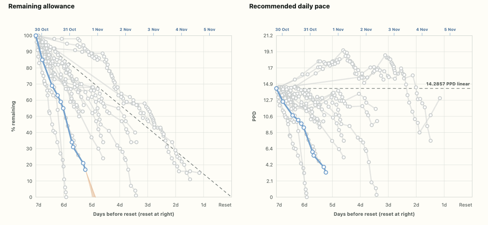

# Token Burn-Rate Helper

A simple, browser-only tool for managing a token or usage allowance. Enter the percentage you have **remaining** and the date and time of the next reset. The helper calculates the pace you can sustain from now until reset, so you can adjust your usage and control where you land in the allowance cycle.



## What it shows

- Remaining time until reset, updated every second.
- Recommended percentage points per day (PPD) and per hour (PPH).
- Time to the ideal linear-consumption level.
- A seven-day view of remaining allowance and recommended daily pace.
- The active cycle in blue and earlier cycles in gray for comparison.
- Average-rate and fastest-rate projections showing when the allowance may reach zero.
- A persistent calculation history with optional notes.

The charts normalize every allowance cycle to seven days, with the reset at the right edge. If the initial point is missing, the visualization infers a starting point of 100% exactly seven days before reset. This inferred point is used for the chart and projections; it does not alter the saved history.

The orange projection area represents the range between the average burn rate and the fastest observed burn rate. Hover over the projection to see both estimated finish times.

## Calculations

The entered percentage is the allowance **remaining**, not the amount already used.

```text
PPD = percentage remaining / fractional 24-hour days until reset
PPH = percentage remaining / fractional hours until reset
```

Rates are expressed in percentage points, not relative percentage changes. The linear reference represents an even decline from 100% to 0% over the seven-day cycle.

## Run locally

No installation or build step is required:

1. Download or clone this repository.
2. Open `index.html` in a modern browser.

Everything is contained in that single HTML file, with no dependencies, server, account, or public API. The page can also be hosted as a static site, including with GitHub Pages.

## History, backup, and privacy

Calculation history and notes are stored only in the browser's `localStorage`. They remain available after a reload, but are specific to that browser and device.

- Download the history as JSON for backup or transfer.
- Upload a previously exported JSON file to restore or add data.
- Delete individual entries or clear the complete history when needed.

The app sends no data to a server and includes no tracking. Clearing the browser's site data may remove the local history, so export a JSON backup before doing so.

## Supported reset-time formats

Reset times are interpreted in the browser's local timezone. Supported examples include:

- `7 Sept 2026, 11:54`
- `7 September 2026 11:54`
- `07/09/2026 11:54` (day/month/year)
- `2026-09-07 11:54`
